# PsychoLogger 🧠📊

<p align="center">
  
</p>

<p align="center">
  <a href="https://www.gnu.org/licenses/gpl-3.0"></a>
  <a href="https://www.android.com"></a>
  <a href="https://kotlinlang.org"></a>
  <a href="https://github.com/D4vRAM369/PsychoLogger/releases/latest"></a>
  <a href="https://opensource.org"></a>
  <a href="https://en.wikipedia.org/wiki/Project-based_learning"></a>
  
  
</p>

<p align="center">
  <a href="README_Spanish.md">🇮🇨🇪🇸 Versión en Español</a> ·
  <a href="CHANGELOG.md">📋 Full Changelog</a> ·
  <a href="https://github.com/D4vRAM369/PsychoLogger/releases/latest">📥 Download Latest APK</a>
</p>

---

## 🆕 What's New in v1.4

| Feature | Description |
|---------|-------------|
| 🌐 **Full Bilingual UI (EN / ES)** | Complete English and Spanish localization across both native screens and the interactive interface, following your device language |
| 🧪 **2D Molecule Icons & SMILES** | 86 book-oriented skeletal structures from PubChem (`assets/mol/`) + custom `SMILES` rendering (`smiles-drawer` + CSV column), or switch back to classic emojis in *Settings → Appearance* |
| 🔐 **Chunked AES-256-GCM Backups (`chunked-v2`)** | Stream-encrypts and decrypts huge photo/audio libraries in 1 MiB authenticated blocks without `OutOfMemoryError`, with show/hide password eye icon and 8-character minimum |
| 📦 **Async Audio & Photo ZIP Export** | Background compression with a live progress bar (`0/N` files) and optional `AES-256-GCM` password encryption, without freezing the UI |
| ⏱️ **Configurable Auto-Backup & Rotation** | Choose how often Auto-Backup runs (`6h`, `12h`, `24h`, `48h`, `7d`) and how many recent backups to keep (`3`, `5`, `7`, `10`, `15`) |
| ✨ **Interactive Onboarding & Smart Splash** | 6-slide swipeable intro guide and a neon startup animation that runs for the first 4 launches and turns itself off automatically (re-enable anytime in Settings) |
| 🗃️ **True Substance Archiving** | Triple-tap `⋮⋮` to archive: archived substances disappear from the calendar, stats, counters, and CSV export while staying safe in backups; tap *"About the project"* 5 times to view/restore them |
| 🛡️ **Zero Internet Permission** | Release builds strip `android.permission.INTERNET` completely — 100% offline, with external harm-reduction links opened via Android's system browser (`ACTION_VIEW`) |

---

## What is PsychoLogger?

**PsychoLogger** is a private, 100% offline personal logbook for psychonaut experiences and mindful substance tracking on Android. It is designed for harm reduction, self-knowledge, and responsible documentation—keeping all of your entries, voice notes, and photos strictly on your device.

---

## Why Use PsychoLogger?

### 🔒 Total Privacy (Zero Internet Permission)
- **No `INTERNET` permission in release builds** — it is physically impossible for the app to send data anywhere
- **Zero telemetry, zero analytics, zero ads**
- **Biometric & App PIN lock** — fingerprint unlock with dedicated masked App PIN fallback
- **Authenticated encryption (`AES-256-GCM` + `PBKDF2-HMAC-SHA256`, 120,000 iterations)** for full backups, voice notes, and photo exports

### 📝 Rich Experience Logging
- Record **substance, dose, custom unit, date, and exact time** (including the *Time Travel Picker* for past entries)
- Document your **Set** (mindset) and **Setting** (environment), and create custom tags
- Write detailed **Markdown notes** (`*bold*`, `_italic_`, lists, headers)
- Attach **voice notes** (built-in audio recorder/player) and **photos** (camera or gallery) to any entry
- Identify substances with **2D skeletal molecules** (86 built-in structures + custom `SMILES` support) or custom colors and emojis

### 📈 Pattern Visualization & Harm Reduction
- **Interactive Monday-first Calendar** with multi-substance color gradients and per-substance filtering
- **Statistics Dashboard** (streaks, frequency, Set/Setting distribution, active days)
- **Direct Harm Reduction Resources** — quick access to **Erowid**, **TripSit**, **MAPS**, **PsychonautWiki**, **DrugScience**, and a curated **Recommended Books** library

---

## 📸 Screenshots (v1.4)

### 🏠 Main Screen, Calendar & Appearance Settings
<p align="center">
  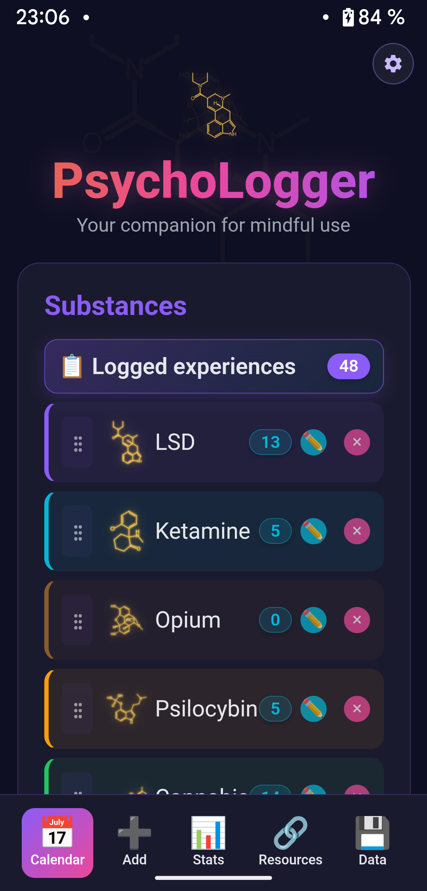
  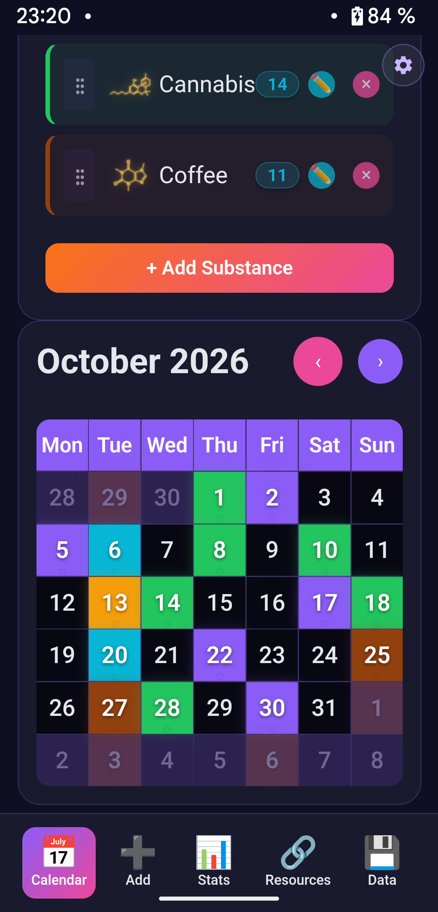
  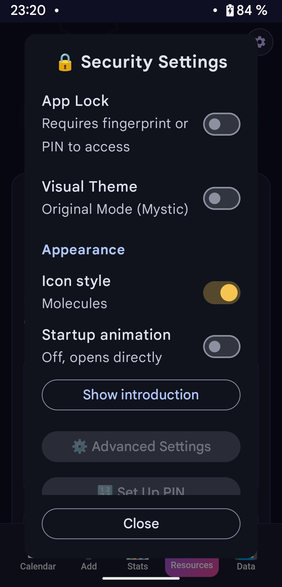
</p>

### 📊 Statistics & Context Analysis
<p align="center">
  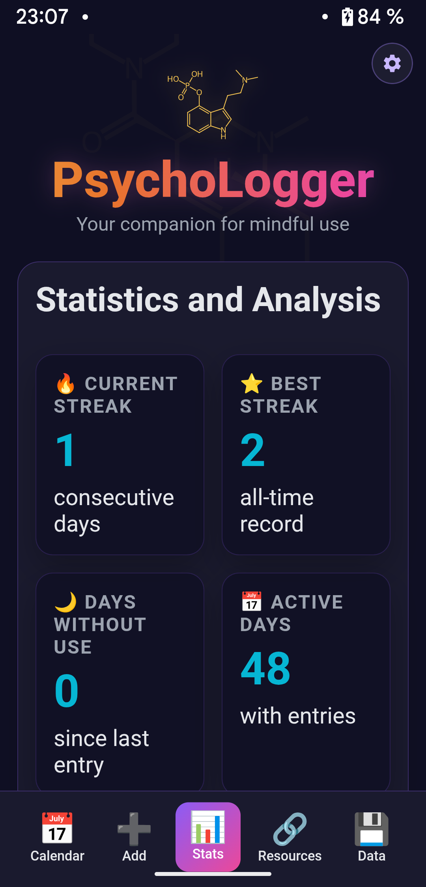
  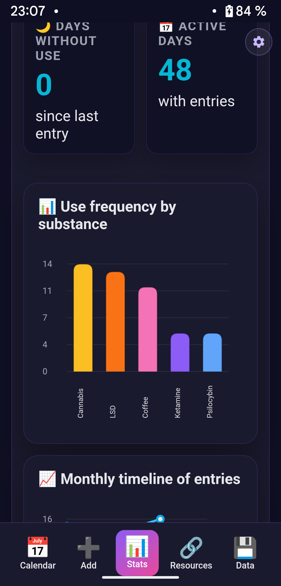
  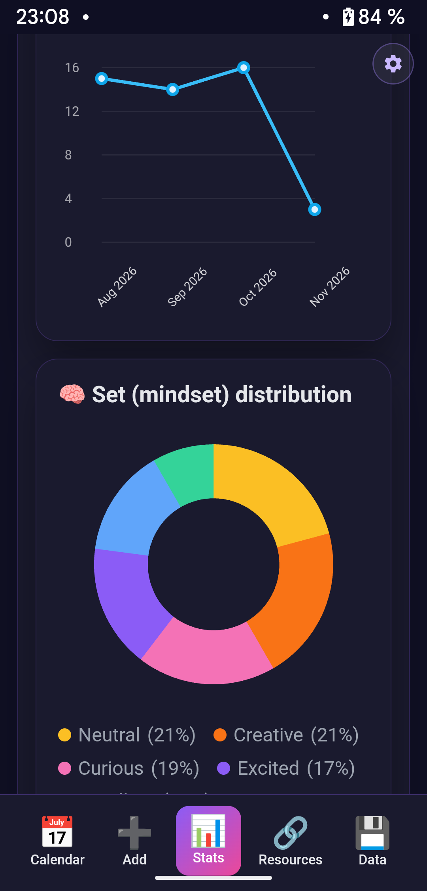
  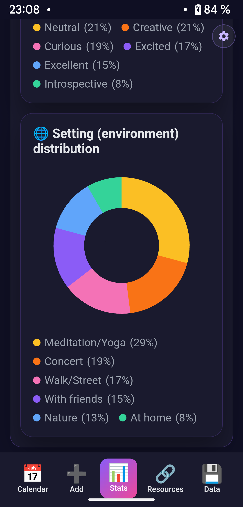
</p>

### 🔗 Harm Reduction Resources, Books & Archived Substances
<p align="center">
  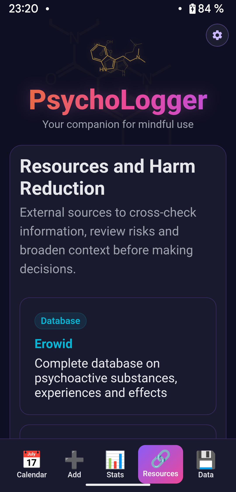
  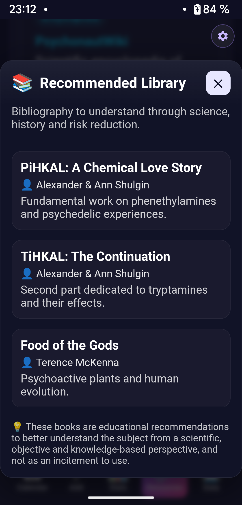
  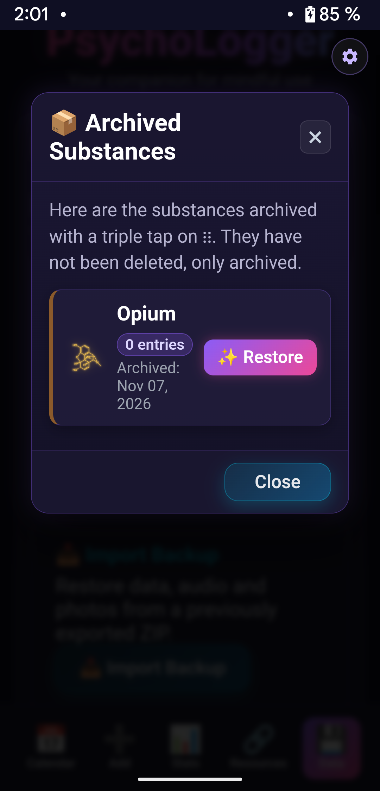
</p>

### 💾 Data Management, Encrypted Backups & Configurable Auto-Backup
<p align="center">
  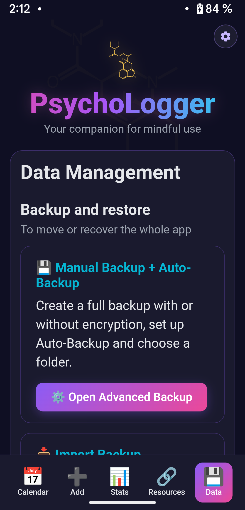
  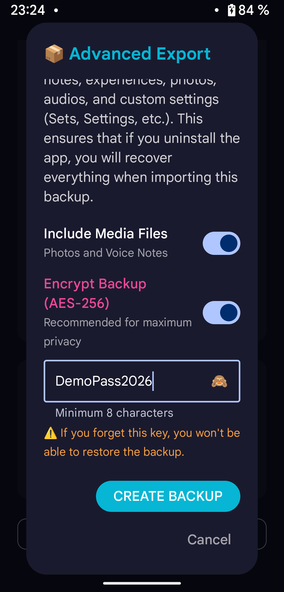
  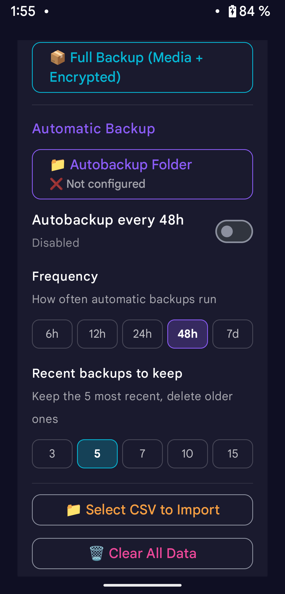
</p>

### 📦 Manual CSV / Media Export & About the Project
<p align="center">
  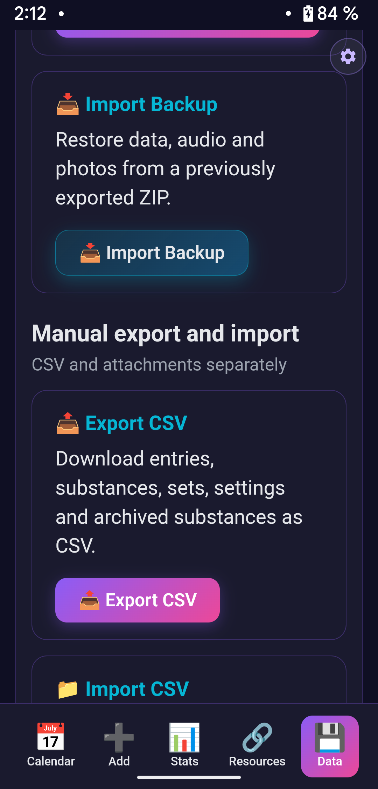
  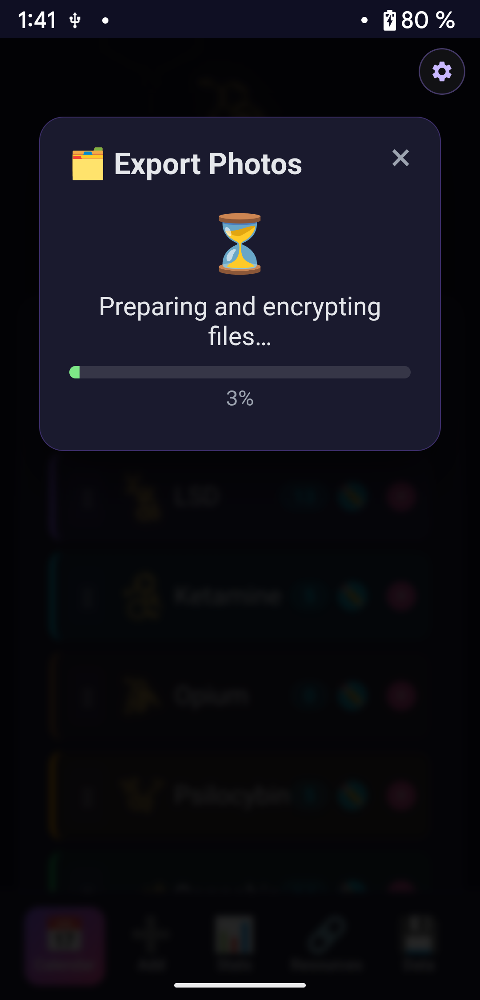
  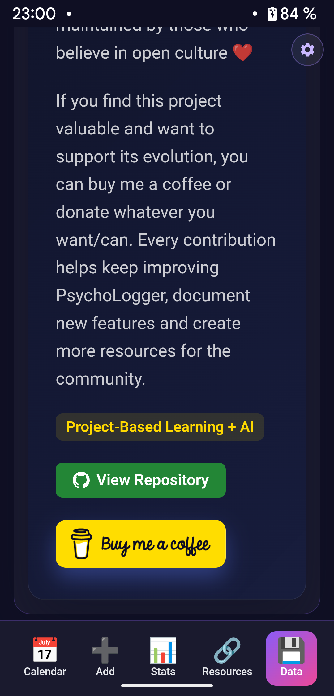
</p>

---

## 🛠️ Installation & Usage

### Requirements
- **Android 8.0 (API 26)** or higher (targets **Android 15 / API 36**)
- ~15 MB of free storage
- Biometric sensor optional (fingerprint + App PIN supported)

### How to Install
1. Download the latest signed APK from [Releases](https://github.com/D4vRAM369/PsychoLogger/releases/latest) or build from source with `./gradlew assembleRelease`
2. Open the app and follow the 6-slide onboarding introduction
3. Optional: tap the top-right ⚙️ gear icon to enable **App Lock** (Fingerprint / PIN), toggle **Molecules vs. Emojis**, or configure **Startup Animation**

### Useful Gestures & Shortcuts
- **Reorder substances:** drag and drop using the `⋮⋮` handle on the left of each substance
- **Archive a substance:** triple-tap on the `⋮⋮` handle
- **View / Restore archived substances:** go to the **Data** tab and tap the **"About the project"** badge **5 times**

---

## 🔓 Decrypting Encrypted Backups, Audio & Photos (`decrypt_psychologger.py`)

When you export an encrypted full backup, audio ZIP, or photo ZIP from PsychoLogger, it uses **`AES-256-GCM`** (`chunked-v2` streaming encryption with `PBKDF2-HMAC-SHA256`, 120,000 iterations). You can restore it directly inside the app or decrypt it on your computer using [`decrypt_psychologger.py`](decrypt_psychologger.py).

### 1. Install Requirements
```bash
sudo apt install python3 python3-pip   # Linux / Debian / Ubuntu
# brew install python3                 # macOS
pip3 install cryptography
```

### 2. Decrypt an Exported ZIP
```bash
# Recommended: omit the password on the command line so it prompts securely
python3 decrypt_psychologger.py photos_encrypted_2026-11-07_02-10-00.zip
🔒 Contraseña: ****
```

The script automatically detects whether the archive uses `chunked-v2` or the legacy single-block format, verifies GCM authentication tags for every 1 MiB block, and extracts your `audios/` and/or `photos/` into `decrypted_audios/`.

---

## 🧱 Tech Stack

- **Kotlin 2.0.21 & Jetpack Compose (Material 3)** — Native security gate, biometric/PIN lock, settings overlay, SAF file management, and `WorkManager` periodic auto-backups
- **Hybrid WebView (`assets/index.html` + `assets/i18n.js`)** — Fast offline UI with local `Chart.js`, `marked.min.js`, `smiles-drawer.min.js`, and 86 PubChem 2D molecular SVGs (`assets/mol/`)
- **Streaming Cryptography (`ChunkedCrypto.kt`)** — `AES-256-GCM` chunked AEAD with per-chunk IV derivation and AAD framing

---

## ⚖️ Harm Reduction Disclaimer

PsychoLogger is built strictly for:
- ✅ **Education** and objective self-documentation
- ✅ **Harm reduction** and pattern awareness
- ✅ **Privacy-preserving personal journaling**

It is **NOT**:
- ❌ An encouragement or promotion of substance use
- ❌ A substitute for professional medical or psychological advice
- ❌ Intended for minors

---

*Developed with ❤️ by **D4vRAM** using a Project-Based Learning (PBL) approach for the responsible psychonaut community.*
