# PsychoLogger 🧠📊

<p align="center">
  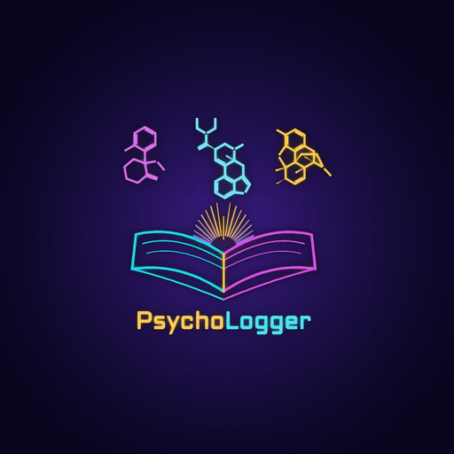
</p>

<p align="center">
  <a href="https://www.gnu.org/licenses/gpl-3.0"></a>
  <a href="https://www.android.com"></a>
  <a href="https://kotlinlang.org"></a>
  <a href="https://github.com/D4vRAM369/PsychoLogger/releases/latest"></a>
  <a href="https://opensource.org"></a>
  <a href="https://en.wikipedia.org/wiki/Project-based_learning"></a>
  
  
</p>

<p align="center">
  <a href="README.md">🇬🇧🇺🇸 English Version</a> ·
  <a href="CHANGELOG.md">📋 Changelog Completo</a> ·
  <a href="https://github.com/D4vRAM369/PsychoLogger/releases/latest">📥 Descargar Última APK</a>
</p>

---

## 🆕 Novedades en v1.4

| Función | Descripción |
|---------|-------------|
| 🌐 **Interfaz Bilingüe Completa (ES / EN)** | Localización total al español e inglés tanto en pantallas nativas como en la interfaz interactiva, adaptándose al idioma del sistema |
| 🧪 **Iconos Moleculares 2D y SMILES** | 86 estructuras esqueléticas 2D oficiales de PubChem (`assets/mol/`) + dibujo de `SMILES` personalizados (`smiles-drawer` + columna CSV), o alterna a emojis clásicos en *Ajustes → Apariencia* |
| 🔐 **Backups Cifrados por Bloques (`chunked-v2`)** | Cifra y descifra bibliotecas enormes de fotos y audios con `AES-256-GCM` en bloques autenticados de 1 MiB sin cierres por memoria (`OutOfMemoryError`), con icono de ojo y mínimo 8 caracteres |
| 📦 **Exportación Asíncrona de Audios y Fotos** | Compresión en segundo plano con barra de progreso en vivo (`0/N` archivos) y cifrado `AES-256-GCM` opcional, sin congelar la pantalla |
| ⏱️ **Auto-Backup y Rotación Configurables** | Elige cada cuánto se ejecuta el Auto-Backup (`6h`, `12h`, `24h`, `48h`, `7d`) y cuántas copias recientes conservar (`3`, `5`, `7`, `10`, `15`) |
| ✨ **Onboarding Interactivo y Splash Inteligente** | Guía deslizable de 6 pantallas en el primer inicio y animación neón de arranque que se apaga sola tras las 4 primeras aperturas (reactivable en Ajustes) |
| 🗃️ **Sustancias Archivadas Rediseñadas** | Triple-tap en `⋮⋮` para archivar: desaparecen del calendario, estadísticas, contadores y CSV pero se conservan en tus backups; toca 5 veces *"Acerca del proyecto"* para verlas y restaurarlas |
| 🛡️ **Cero Permiso de Internet** | La APK de release elimina por completo `android.permission.INTERNET` — 100 % offline; los enlaces de reducción de riesgos se abren con el navegador del sistema (`ACTION_VIEW`) |

---

## ¿Qué es PsychoLogger?

**PsychoLogger** es tu bitácora personal, privada y 100 % offline para documentar experiencias psiconáuticas y llevar un registro consciente en Android. Está diseñada con enfoque de reducción de riesgos y autoconocimiento, manteniendo todos tus registros, notas de voz y fotografías exclusivamente dentro de tu dispositivo.

---

## ¿Por qué usar PsychoLogger?

### 🔒 Privacidad Total (Sin Permiso de Internet)
- **Sin permiso `INTERNET` en compilaciones release** — es físicamente imposible que la app envíe datos fuera de tu teléfono
- **Cero telemetría, cero analíticas, cero anuncios**
- **Desbloqueo por huella dactilar y PIN de la app** — prompt biométrico exclusivo de huella con botón directo al PIN oculto de la aplicación
- **Cifrado autenticado (`AES-256-GCM` + `PBKDF2-HMAC-SHA256`, 120.000 iteraciones)** para backups completos, notas de voz y exportación de fotografías

### 📝 Registro Completo de Experiencias
- Registra **sustancia, dosis, unidad personalizada, fecha y hora exacta** (incluyendo *Bitácora Temporal* para experiencias pasadas)
- Documenta tu **Set** (estado mental) y **Setting** (entorno), y añade etiquetas propias
- Escribe notas detalladas con **formato Markdown** (`*negrita*`, `_cursiva_`, listas, encabezados)
- Adjunta **notas de voz** (grabadora/reproductor integrado) y **fotografías** (cámara o galería) en cada entrada
- Identifica tus sustancias con **estructuras moleculares 2D** (86 incluidas + soporte `SMILES` propio) o con colores y emojis

### 📈 Visualización de Patrones y Reducción de Daños
- **Calendario interactivo (semana desde el lunes)** con gradientes multicolor por día y filtro por sustancia
- **Panel de Estadísticas** (rachas, frecuencia de uso, distribución de Set y Setting, días activos)
- **Recursos de Reducción de Riesgos** — acceso directo a **Erowid**, **TripSit**, **MAPS**, **PsychonautWiki**, **DrugScience** y biblioteca de **Libros Recomendados**

---

## 📸 Capturas de Pantalla (v1.4)

### 🏠 Pantalla Principal, Calendario y Ajustes de Apariencia
<p align="center">
  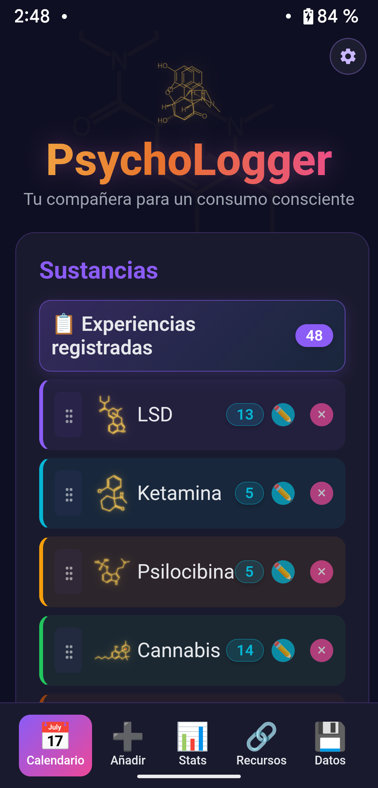
  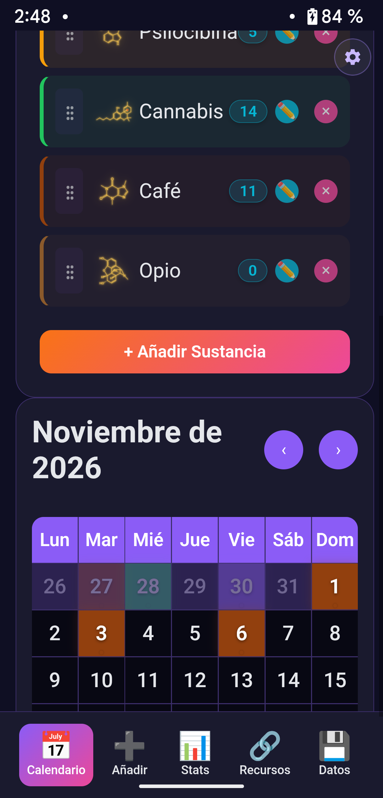
  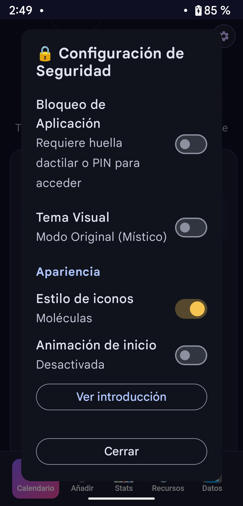
</p>

### 📊 Estadísticas y Análisis de Contexto
<p align="center">
  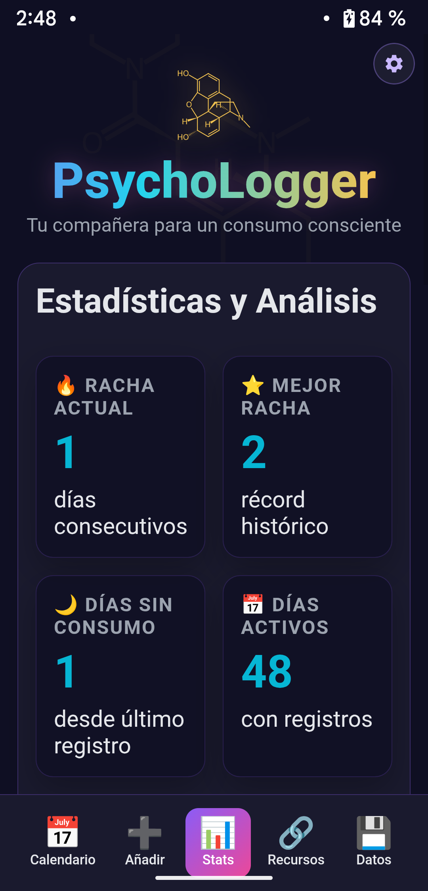
  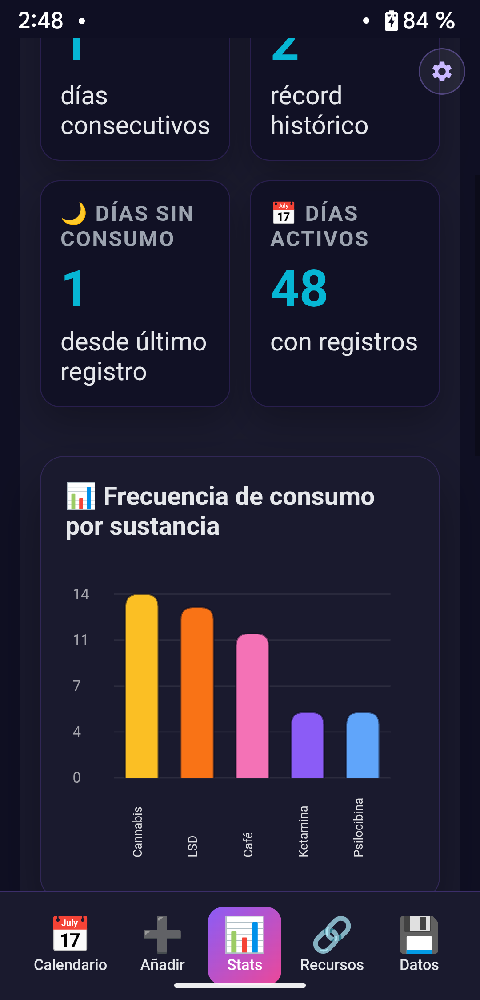
  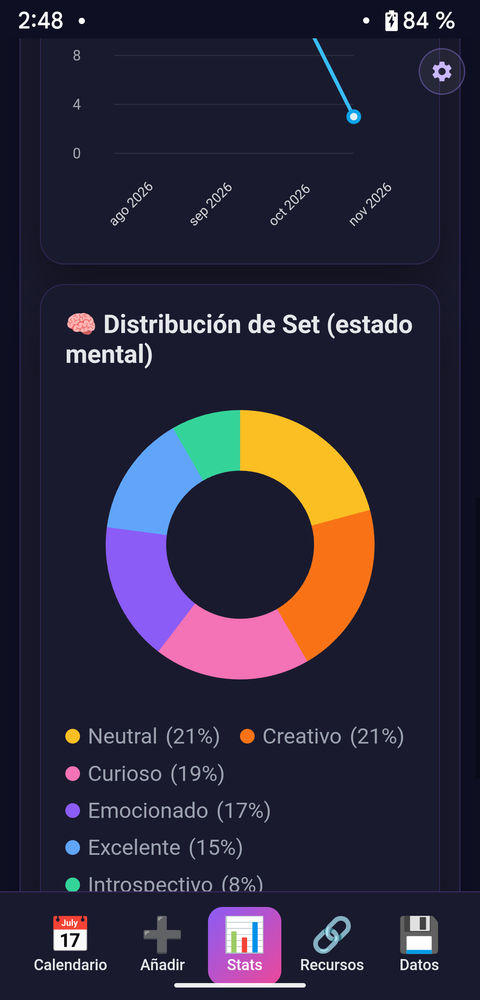
  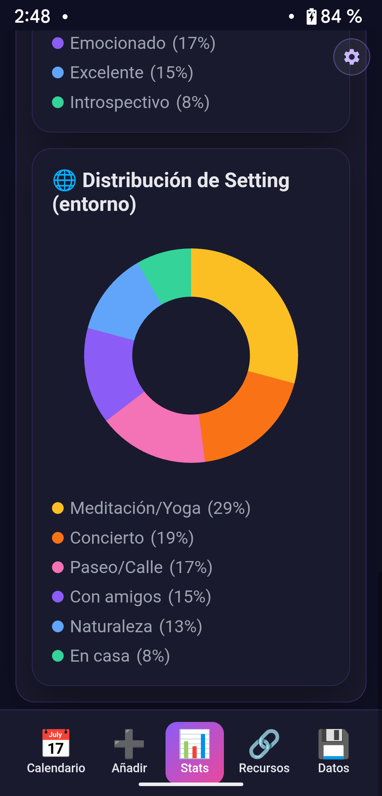
</p>

### 🔗 Recursos de Reducción de Daños, Libros y Sustancias Archivadas
<p align="center">
  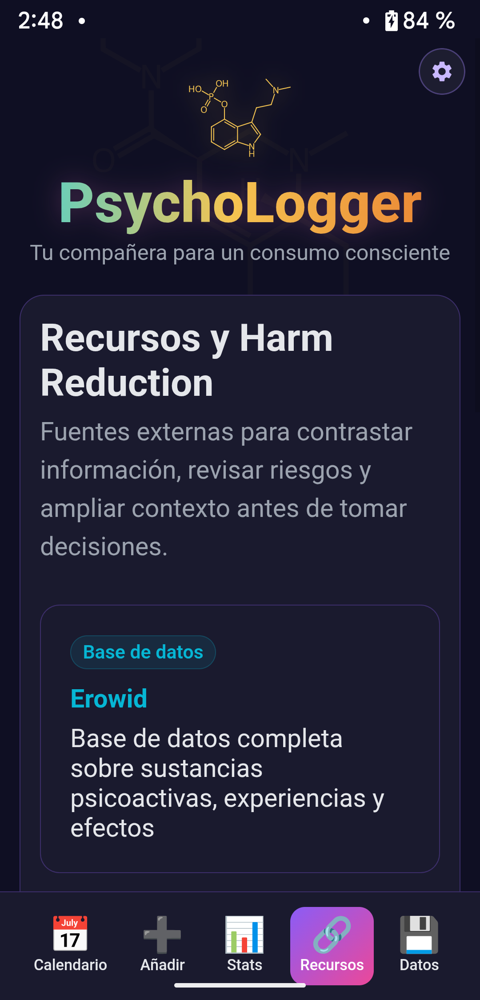
  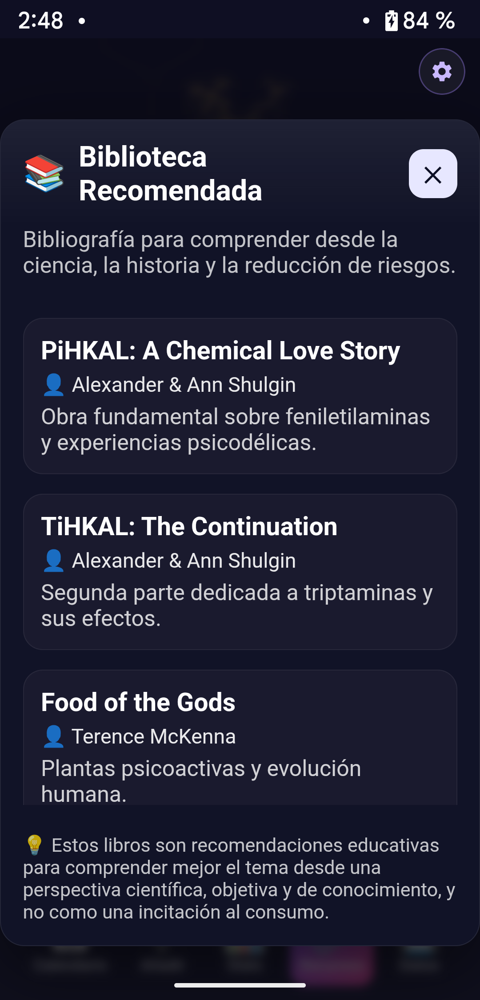
  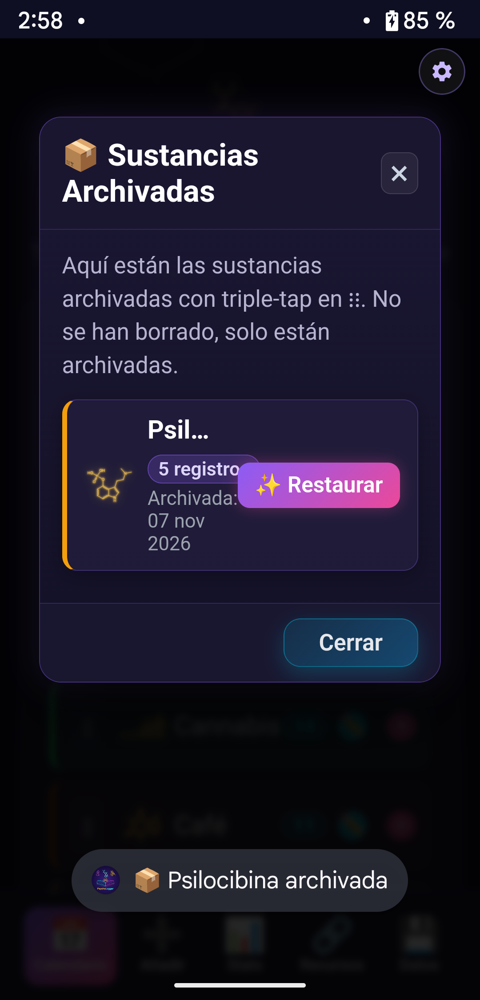
</p>

### 💾 Gestión de Datos, Backups Cifrados y Auto-Backup Configurable
<p align="center">
  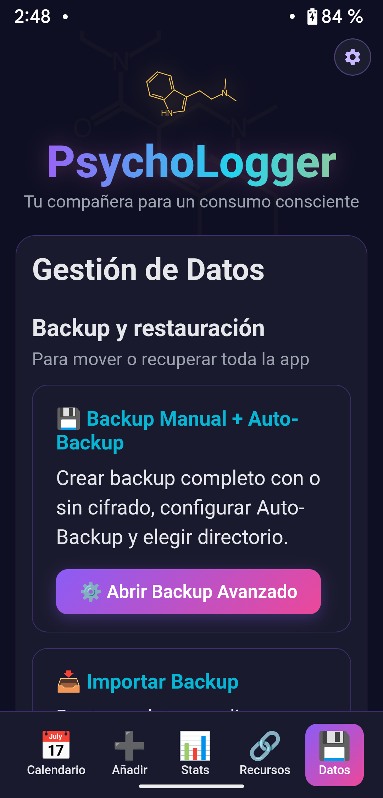
  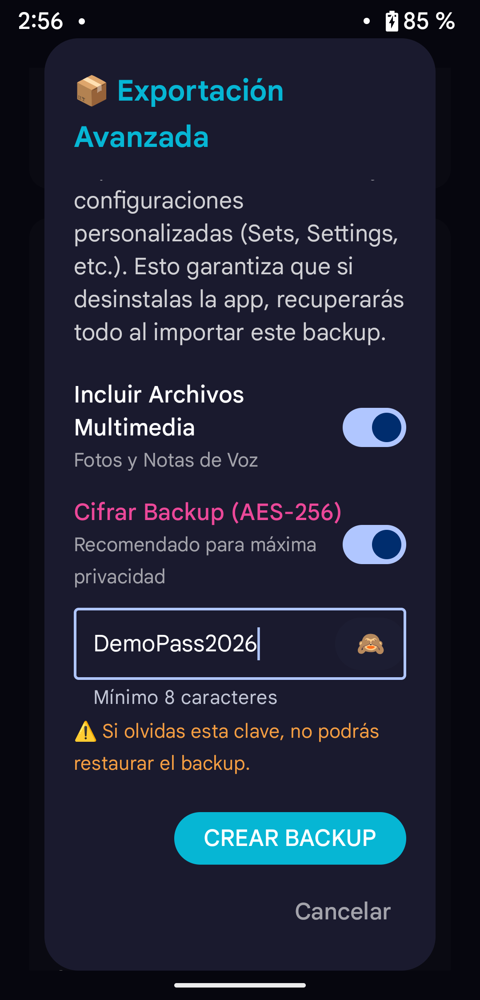
  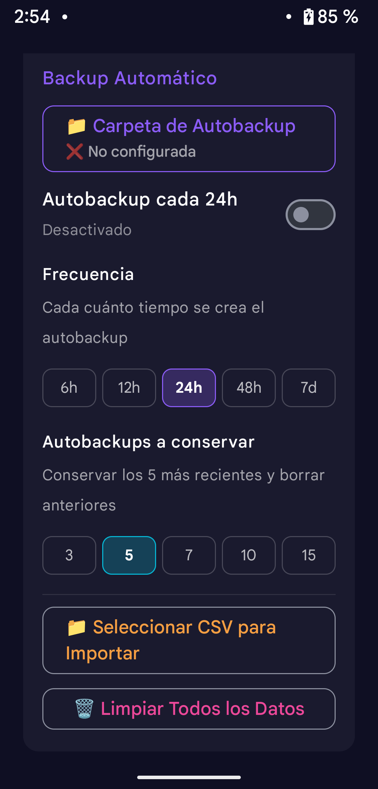
</p>

### 📦 Exportación Manual CSV / Multimedia y Acerca del Proyecto
<p align="center">
  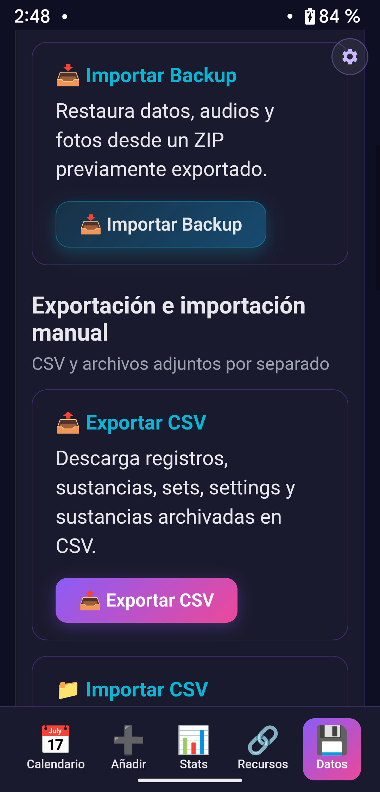
  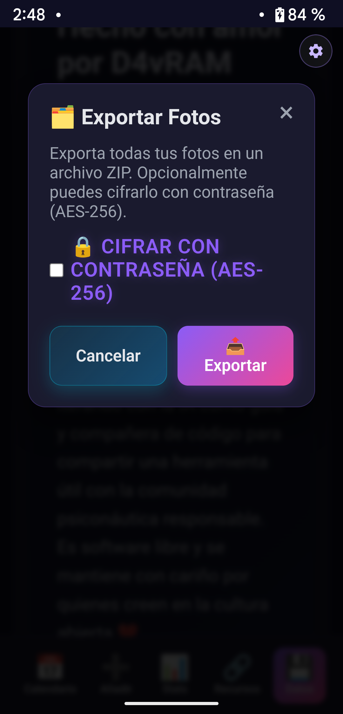
  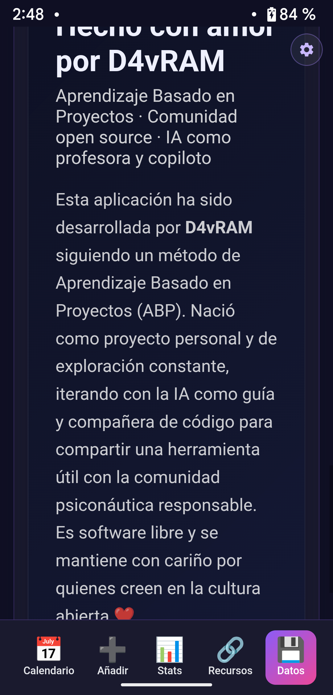
</p>

---

## 🛠️ Instalación y Uso

### Requisitos
- **Android 8.0 (API 26)** o superior (compilado para **Android 15 / API 36**)
- ~15 MB de espacio libre
- Sensor de huella dactilar opcional (soporta huella + PIN de la aplicación)

### Cómo Instalar
1. Descarga la última APK firmada desde [Releases](https://github.com/D4vRAM369/PsychoLogger/releases/latest) o compílala desde el código fuente con `./gradlew assembleRelease`
2. Abre la aplicación y recorre las 6 pantallas de introducción
3. Opcional: pulsa el icono de engranaje ⚙️ arriba a la derecha para activar el **Bloqueo de App** (Huella / PIN), alternar entre **Moléculas y Emojis** o configurar la **Animación de inicio**

### Gestos y Atajos Útiles
- **Reordenar sustancias:** mantén pulsado y arrastra el icono `⋮⋮` a la izquierda de cada sustancia
- **Archivar una sustancia:** haz **triple-tap** sobre el icono `⋮⋮`
- **Ver / Restaurar sustancias archivadas:** ve a la pestaña **Datos** y toca **5 veces** el chip **"Acerca del proyecto"**

---

## 🔓 Desencriptar Backups, Audios y Fotos Cifrados (`decrypt_psychologger.py`)

Cuando exportas un backup completo, un ZIP de audios o un ZIP de fotos cifrado desde PsychoLogger, se protege con **`AES-256-GCM`** (`chunked-v2` por bloques con `PBKDF2-HMAC-SHA256` y 120.000 iteraciones). Puedes restaurarlo directamente desde la app o desencriptarlo en tu ordenador con [`decrypt_psychologger.py`](decrypt_psychologger.py).

### 1. Instalar Requisitos
```bash
sudo apt install python3 python3-pip   # Linux / Debian / Ubuntu
# brew install python3                 # macOS
pip3 install cryptography
```

### 2. Desencriptar un ZIP Exportado
```bash
# Recomendado: sin contraseña en el comando para escribirla de forma oculta
python3 decrypt_psychologger.py photos_encrypted_2026-11-07_02-10-00.zip
🔒 Contraseña: ****
```

El script detecta automáticamente si el archivo usa el formato por bloques `chunked-v2` o el formato legacy, verifica la integridad criptográfica GCM de cada bloque de 1 MiB y extrae tus `audios/` y/o `photos/` en la carpeta `decrypted_audios/`.

---

## 🧱 Stack Tecnológico

- **Kotlin 2.0.21 y Jetpack Compose (Material 3)** — Candado de seguridad nativo, biometría/PIN, panel de ajustes, gestión de archivos SAF y `WorkManager` para auto-backups periódicos
- **Hybrid WebView (`assets/index.html` + `assets/i18n.js`)** — Interfaz offline de respuesta inmediata con `Chart.js`, `marked.min.js`, `smiles-drawer.min.js` y 86 estructuras moleculares SVG de PubChem (`assets/mol/`)
- **Criptografía en Streaming (`ChunkedCrypto.kt`)** — `AES-256-GCM` autenticado por bloques con derivación determinista de IV y metadatos AAD

---

## ⚖️ Aviso de Reducción de Daños

PsychoLogger está diseñada exclusivamente para:
- ✅ **Educación** y documentación objetiva personal
- ✅ **Reducción de riesgos** y análisis de patrones de consumo
- ✅ **Autoconocimiento** con privacidad absoluta

**NO es:**
- ❌ Una promoción o incitación al consumo de sustancias
- ❌ Un sustituto del consejo médico o psicológico profesional
- ❌ Una herramienta destinada a menores de edad

---

*Desarrollado con ❤️ por **D4vRAM** mediante Aprendizaje Basado en Proyectos (ABP / PBL) para la comunidad psiconáutica responsable.*
